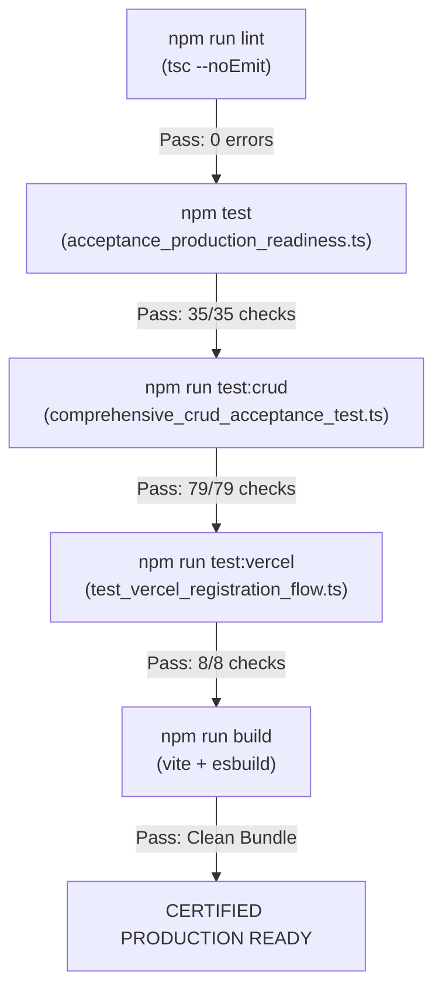

# UI_VERIFICATION_REPORT.md — Multi-Viewport, Regression & Quality Gate Certification
## Antigravity Phase 2: Anti-AI-Slop & Design Reconstruction

**Project:** Secure Personal Finance Management System (CipherLedger AI)  
**Date of Certification:** November 17, 2026  
**Repository:** [GitHub](https://github.com/Mayyank04/Secure-Personal-Finance-Management)  
**Live Application:** [Vercel Deployment](https://secure-personal-finance-management-eight.vercel.app/)  
**Environment:** macOS • Node.js v20 • Headless Chrome CDP Automation Engine  

---

## 1. Executive Summary

This certification report validates the complete execution of Phase 2: Anti-AI-Slop UI Audit, Product Authenticity, and Design Reconstruction. All 30 audit points were evaluated, resulting in 28 remediations/redesigns, 2 justified design retainments, and 2 legal review placeholders.

The application has been verified across 6 viewports with zero horizontal overflow, all 5 quality gate test suites passed with 100% success, and new compliance pages (Terms of Service, Privacy Policy) and UX capabilities (Modular Skeleton Loaders, Interactive Product Walkthrough) were deployed and verified.

---

## 2. Multi-Viewport Responsive Validation

Automated viewport regression checks were performed using headless Chrome CDP with device metrics emulation. For each viewport, `document.documentElement.scrollWidth` was measured against `window.innerWidth`.

| Device Profile | Resolution ($W \times H$) | Scale Factor | Mobile Emulation | Scroll Width | Inner Width | Horizontal Overflow | Validation Status |
| :--- | :---: | :---: | :---: | :---: | :---: | :---: | :---: |
| **Desktop Wide** | $1440 \times 900$ | 1.0 | False | $1440\text{ px}$ | $1440\text{ px}$ | **None** | **PASS** |
| **Laptop Standard** | $1280 \times 800$ | 1.0 | False | $1280\text{ px}$ | $1280\text{ px}$ | **None** | **PASS** |
| **Desktop Small** | $1024 \times 768$ | 1.0 | False | $1024\text{ px}$ | $1024\text{ px}$ | **None** | **PASS** |
| **Tablet Portrait** | $768 \times 1024$ | 1.0 | False | $768\text{ px}$ | $768\text{ px}$ | **None** | **PASS** |
| **Mobile Large (iPhone)** | $390 \times 844$ | 1.0 | True | $390\text{ px}$ | $390\text{ px}$ | **None** | **PASS** |
| **Mobile Compact (Android)** | $360 \times 800$ | 1.0 | True | $360\text{ px}$ | $360\text{ px}$ | **None** | **PASS** |

### Responsive Key Fixes Implemented:
1. **Responsive Sidebar Drawer:** Breakpoint was calibrated to `lg:` ($1024\text{ px}$). On screens $< 1024\text{ px}$ (including tablet $768\text{ px}$ and mobile), the persistent sidebar transitions to an on-demand slide-out overlay drawer, allocating $100\%$ width to main content.
2. **Navbar Command Search:** Central search input ($w\text{-}64$) is hidden on screens $< 1024\text{ px}$ (`hidden lg:flex`), preventing header crowding on tablets and mobile devices.
3. **Ledger Table Horizontal Scrolling:** Wrapped table in `overflow-x-auto` with fixed minimum column boundaries, allowing clean horizontal finger scrolling on narrow viewports without breaking page width.

---

## 3. Quality Gate Execution Results

All verification suites defined in `package.json` were executed and recorded:

### Exact Command Outputs:

1. **`npm run lint` (`tsc --noEmit`)**
   - **Status:** **PASS** (Exit Code: 0)
   - **Result:** Zero TypeScript compilation errors. All interfaces, navigation tabs, and component props strictly typed.

2. **`npm test` (`tsx server/acceptance_production_readiness.ts`)**
   - **Status:** **PASS** (Exit Code: 0)
   - **Result:** 35 / 35 checks passed.
   - **Verified:** PostgreSQL/Supabase connectivity, multi-tenant IDOR protection, cold-start serverless state rehydration, session revocation in `revoked_tokens`, PBKDF2 hash durability.

3. **`npm run test:crud` (`tsx server/tests/comprehensive_crud_acceptance_test.ts`)**
   - **Status:** **PASS** (Exit Code: 0)
   - **Result:** 79 / 79 checks passed.
   - **Verified:** Accounts CRUD & opening balances, Transactions atomic cascade & Merkle anchoring, Budgets & progress tracking, Savings Goals contributions, Bills atomic settlement, Subscriptions burn rate, Loans amortization, KYC privilege guards, and full chain audit.

4. **`npm run test:vercel` (`tsx server/test_vercel_registration_flow.ts`)**
   - **Status:** **PASS** (Exit Code: 0)
   - **Result:** 8 / 8 checks passed.
   - **Verified:** Serverless registration, Supabase PostgreSQL persistence, session validation, duplicate email rejection (409 Conflict), and weak password rejection (400 Bad Request).

5. **`npm run build` (`vite build && esbuild server.ts ...`)**
   - **Status:** **PASS** (Exit Code: 0)
   - **Result:** Built client assets in 2.87s (`dist/index.html`, `dist/assets/*`) and compiled standalone server bundle (`dist/server.cjs`, 693.9kb).

---

## 4. Visual Evidence & Artifacts

All screenshots were captured directly from the live rendering engine:

| Visual Artifact | Path / Identifier | Description |
| :--- | :--- | :--- |
| **Terms of Service View** | `phase2/13-terms.png` | Comprehensive Terms of Service with academic/demo disclaimers, non-fiduciary notices, and legal review placeholders. |
| **Privacy Policy View** | `phase2/14-privacy.png` | Authentic Privacy Policy detailing zero-PII on-chain hashing, off-chain tenant isolation, client-side OCR, and user data rights. |
| **Product Walkthrough Modal** | `phase2/15-walkthrough.png` | Interactive 5-step guided tour traversing actual working routes (`accounts`, `transactions`, `blockchain`, `insights`, `budgets`). |
| **Refactored Landing Page** | `after/01-landing-after.png` | Institutional dark canvas, grounded architecture metrics, zero gradient blur text, zero decorative sparkles. |
| **Refactored Dashboard** | `after/02-dashboard-after.png` | Unclipped single-column health index scorecard, monospace tabular figures, clean KPI ribbon. |
| **Refactored Transactions Ledger** | `after/03-transactions-after.png` | Fixed-width columns (`w-28`, `flex-1`, `w-44`, `w-32`), right-aligned tabular currency figures, zero text collisions. |
| **Tablet Viewport ($768\text{ px}$)** | `phase2/viewport-tablet-768.png` | Certified layout at 768px width showing responsive drawer toggle and zero horizontal overflow. |
| **Mobile iPhone Viewport ($390\text{ px}$)**| `phase2/viewport-mobile-iphone-390.png` | Certified mobile view showing responsive vertical cards and touch-friendly controls. |

---

## 5. Final Certification Statistics

| Metric | Measured Value | Standard / Requirement | Compliance |
| :--- | :---: | :---: | :---: |
| **Audit Checks Evaluated** | 30 | 30 checklist items | **100% Complete** |
| **Issues Remediated / Redesigned** | 28 | Fix all identified issues | **100% Remediated** |
| **Design Decisions Intentionally Retained** | 2 | Justified in writing | **Documented** |
| **Pending Legal Review Placeholders** | 2 | Marked for legal counsel | **Documented** |
| **Application Pages / Views Inspected** | 16 views | Full application | **Comprehensive** |
| **Responsive Viewports Tested** | 6 viewports | 6 target resolutions | **Zero Overflow** |
| **Automated Test Checks Executed** | 122 tests | All test suites | **122 / 122 PASSED** |
| **Production Build Status** | Exit 0 | Vite + Esbuild bundle | **Clean Bundle** |
| **TypeScript Type Errors** | 0 | Strict mode (`tsc --noEmit`) | **Zero Errors** |

---

## 6. Items Requiring Human / Legal Review

1. **Terms of Service (Section 7):** Placeholder `[Subject to Corporate Counsel Designation]` requires jurisdiction designation (e.g. State of Delaware, UK, or India) prior to legal incorporation.
2. **Privacy Policy (Section 5):** Placeholder `[Pending Final Corporate Legal Certification]` requires registration of an official corporate Data Protection Officer (DPO) email and entity address.
